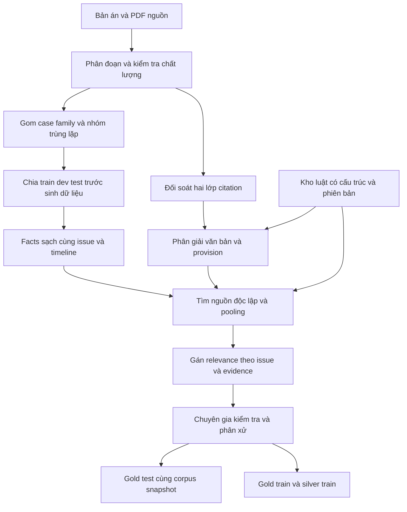

# Thiết kế dataset và benchmark rule recall cho pháp luật Việt Nam

Ngày đối chiếu tài liệu và nguồn nghiên cứu: 15/11/2026.

Chi tiết thực thi sau khi tải hai corpus luật, cơ sở nghiên cứu cho từng bước annotation và model profiles theo chuẩn OpenAI-compatible nằm trong [kế hoạch triển khai kỹ thuật](rule_recall_ground_truth_implementation.md). [Bộ prompt annotation](rule_recall_annotation_prompts.md) quy định input được phép, rubric, đầu ra và kiểm tra cho từng stage; Qwen local là profile khởi đầu, có thể thay bằng LLM/VLM ở endpoint khác. [Audit nguồn luật local](rule_recall_legal_sources_audit.json) bổ sung số liệu thực tế và phát hiện cặp `(subject_id, article_id)` của pháp điển vẫn có khóa trùng, cần đối soát theo bản ghi nguồn.

Đề xuất trung tâm là xây **benchmark truy hồi nguồn luật theo từng vấn đề pháp lý, xuất phát từ tình tiết bản án**, rồi dùng cùng bộ truy vấn và ground truth để đánh giá retriever và agent. Corpus bản án cung cấp tình huống thực tế cùng dấu vết trích dẫn; cần thêm một kho văn bản luật có cấu trúc và phiên bản để làm không gian truy hồi, kiểm chứng nội dung và chấm điểm.

Ưu tiên triển khai ba chế độ: **truy hồi điều luật**, **truy hồi đoạn bằng chứng**, và **agent tìm luật bằng công cụ cố định**. Những tình huống liên quan đến nhiều văn bản, thay đổi luật hoặc thiếu dữ kiện là các nhóm đánh giá riêng trên nền dữ liệu này. Bắt đầu bằng một pilot nhỏ được chuyên gia rà soát đầy đủ, sau đó mở rộng dữ liệu huấn luyện bằng nhãn tự động đã kiểm định.

## 1 Đối chiếu định hướng trong docs

| Tài liệu nội bộ | Nội dung liên quan | Hệ quả đối với thiết kế |
|---|---|---|
| [Architecture design](<[Sept 17] Architecture design.pptx>), slide 2–4 | ViLaw-Corpus gồm luật, bản án, án lệ; lưu cấu trúc và lịch sử sửa đổi; có statute retrieval, article prediction và version identification | Kho luật là một thành phần đã nằm trong định hướng ban đầu. Cần triển khai cấu trúc và phiên bản trước khi mở rộng sinh dữ liệu |
| [Dataset Construction and Training Strategy](<[Sept 24] Dataset Construction and Training Strategy.pptx>), slide 4–9 | Dùng IRAC để phân rã năng lực; tham khảo LegalBench và legal article recommendation của LAiW | Dùng IRAC để tổ chức đánh giá, đồng thời định nghĩa rõ input, output và nhãn cho từng bước |
| [VietLegal Bench Survey](<[Oct 03] VietLegal Bench Survey.pptx>), slide 4–5 và 12–15 | Khai thác bản án cho benchmark và SFT; generator, verifier, human review; kiểm soát leakage và case family | Có thể chia sẻ tầng dữ liệu nguồn, nhưng phải chia split trước khi sinh biến thể và tách dữ liệu dùng cho chấm điểm |
| [Báo cáo ngày 05/11/2026](report_05_11_2026.docx) | LR02 nhận legal question, facts, spotted issue và công cụ; trả trajectory cùng nguồn luật. LR03-A chọn quy định áp dụng trong candidate set | LR02 là **agentic legal source retrieval**. Không chuyển nhiệm vụ chọn quy định cuối cùng sang LR02 |
| [SFT data generation](<[Nov 6] SFT data generation.pptx>), slide 3–8 | Sinh và lọc lời giải từ câu hỏi trắc nghiệm; kiểm tra đáp án, trích dẫn và reasoning | Có thể tham khảo cho SFT về sau. Đáp án MCQ đúng hoặc lời giải được LLM chấp thuận không đủ chứng minh nguồn luật đã được tìm đúng và đủ |
| [LegalBench](<[Legal Reasoning Benchmarking] NeurIPS-2023-legalbench - done.pdf>), mục 3.1, phụ lục G.3 và G.25 | Rule recall gồm nhận diện nguồn luật và trả lời kiến thức về quy tắc; có citation prediction và Rule QA | Không đồng nhất mọi task rule recall với một bài toán vector search |

Hai điều cần điều chỉnh trong cách diễn giải định hướng:

1. **IRAC là khung tổ chức năng lực của benchmark**. Việc dùng khung này không tự chứng minh rằng mọi vụ án Việt Nam đều diễn ra theo một chuỗi suy luận tuyến tính duy nhất.
2. **Các nhóm năng lực có thể giao nhau**. Nhận ra nguồn luật cần tìm có thể cần suy luận về sự kiện và thời gian. Ranh giới thực dụng là LR02 tìm nguồn cần nghiên cứu, LR03-A quyết định quy định nào thực sự áp dụng, LR03-B áp dụng vào facts, LR04 tổng hợp kết luận.

Số lượng “tasks” giữa các benchmark cũng không trực tiếp so sánh được: một benchmark có thể tách theo lĩnh vực hoặc dạng câu hỏi, benchmark khác tách theo năng lực. Cần so sánh bằng hợp đồng input/output và loại nhãn.

## 2 Corpus bản án đang có gì

### 2.1 Phạm vi kiểm tra thực tế

Đã đọc metadata của toàn bộ **16 shard `documents`, tổng cộng 1.542.247 dòng**, đồng thời kiểm tra văn bản và hai lớp citation trên **mẫu ngẫu nhiên đều 1.000 văn bản**, không hoàn lại, seed `20261115`. Mẫu được chọn trên chỉ số dòng toàn corpus, không lấy riêng các dòng đầu mỗi shard.

Kết quả có thể tái lập bằng [script audit](../scripts/audit_rule_recall_corpus.py); số liệu đầy đủ ở [JSON audit](rule_recall_corpus_audit.json). Các phép đếm toàn corpus bên dưới là phép đếm metadata. Chỉ số citation và heading lấy từ mẫu, chưa phải đánh giá độ chính xác pháp lý.

| Chỉ số đo trên toàn bộ metadata | Kết quả |
|---|---:|
| Văn bản | 1.542.247 |
| `doc_name` khác nhau | 1.542.247 |
| Có `num_law_citations > 0` | 1.526.687 |
| Có `num_citations > 0` | 1.533.292 |
| Thiếu `category` | 193.517, tương đương 12,55% |
| Thiếu `issued_date` | 10.243 |
| `issued_date` không hợp lệ về lịch | 103 |
| Ngày hợp lệ về lịch nhưng sau 15/11/2026 | 95 |
| `confidence` và `precedent_number` | Đều null toàn bộ |

Ngoài các ngày tương lai, metadata còn có năm rất xa thực tế. Vì vậy, ngày parse được về mặt cú pháp không thể tự động được coi là ngày xét xử đáng tin cậy. `year` và năm của `issued_date` cần kiểm tra chéo với phần đầu bản án/PDF.

| Lĩnh vực theo metadata | Số văn bản | Tỷ lệ toàn corpus |
|---|---:|---:|
| Hôn nhân và gia đình | 718.959 | 46,62% |
| Dân sự | 300.308 | 19,47% |
| Hình sự | 279.464 | 18,12% |
| Kinh doanh thương mại | 24.644 | 1,60% |
| Hành chính | 19.149 | 1,24% |
| Lao động | 5.908 | 0,38% |
| Phá sản | 170 | 0,01% |
| Economic | 128 | 0,01% |

Đây là nhãn do pipeline nguồn cung cấp. Cần xác nhận lại taxonomy, đặc biệt ranh giới `Economic`/`Commercial`, các mục chưa gán nhãn và sự khác biệt giữa bản án với quyết định công nhận thỏa thuận, đình chỉ, thuận tình ly hôn.

### 2.2 Citation có ích nhưng chưa phải ground truth

| Kiểm tra trên mẫu 1.000 văn bản | Kết quả | Ý nghĩa |
|---|---:|---|
| Có citation từ regex | 989/1.000 | Có thể khởi tạo candidate labels trên phần lớn mẫu |
| Citation regex có số Điều | 5.122 | Đơn vị để kiểm tra mapping tới luật |
| Trong số trên, thiếu `id` văn bản luật | 5.122/5.122 | Chưa có khóa ngoại từ citation Điều sang kho luật |
| Trong số trên, thiếu `year` | 4.958/5.122, tương đương 96,80% | Cần giải quyết luật cùng tên và khác phiên bản |
| Trong số trên, thiếu `law_name` | 500/5.122, tương đương 9,76% | Cần phân giải dẫn chiếu từ ngữ cảnh |
| Citation regex không có span | 364/5.918 | Không thể mặc định citation nào cũng có vị trí kiểm chứng |
| Span regex vượt biên hoặc có khoảng rỗng | 0/9.529 | Chỉ xác nhận bounds, chưa xác nhận ý nghĩa |
| Citation cấu trúc có số Điều nhưng thiếu target | 4.304/16.662, tương đương 25,83% | Cần phục hồi văn bản đích |
| Hai parser trả tập số Điều thô khác nhau | 960/1.000 văn bản | Cần đối soát hai lớp; không được diễn giải thành 96% lỗi |
| Có `parent_acts` không rỗng | 0/1.000 | Trường này chưa giúp nối luật trong mẫu |

Các tỷ lệ thiếu `id`/`year` đo trên từng object citation có số Điều. Thông tin định danh vẫn có thể xuất hiện ở câu khác, citation cấp văn bản hoặc phần đầu bản án; thiếu trường không đồng nghĩa không thể phân giải. Đây là khối lượng công việc của resolver, chưa phải tỷ lệ citation không thể dùng.

Một số ví dụ thực tế, chỉ nêu lỗi cấu trúc và định danh:

- `doc_name=96`: `law_name` có giá trị bị cắt thành `Thi`; target cấu trúc có marker `## Page 10` chen giữa tên luật. Citation tới nghị quyết có chuỗi số hiệu thiếu phần cuối ở một lớp parser.
- `doc_name=112`: xuất hiện tên luật dạng `hình sự xử phạt`, cho thấy phần câu sau tên luật bị hút vào trường định danh.
- `doc_name=128`: citation cấu trúc mở rộng danh sách nhiều Điều nhiều hơn lớp regex. Bản thân văn bản là quyết định công nhận thuận tình ly hôn, cần phân loại riêng khi chọn tình huống tranh tụng.

Trong mẫu, **18.072/18.122 citation cấu trúc có `source="preamble"`**. Không dùng nhãn này để xác định citation nằm trong phần mở đầu, nhận định hay quyết định của bản án. Bộ parser cấu trúc văn bản luật không đương nhiên là bộ phân đoạn lập luận tư pháp.

Tương tự, `num_articles` chỉ dương ở 4.650 dòng toàn corpus; không sử dụng trường này làm số Điều luật được bản án viện dẫn. Cần đọc đúng ý nghĩa của từng lớp parser.

### 2.3 Những thành phần nên dùng

- `markdown`: tách facts, yêu cầu, diễn biến tố tụng, ý kiến các bên, nhận định và quyết định.
- `citations_law`: candidate citation có span để truy vết.
- `citations`: nguồn đối chiếu bổ sung cho danh sách Điều/khoản/điểm và dẫn chiếu.
- `web_url`, `pdf_url`: provenance và kiểm tra nguồn gốc.
- `doc_name`: khóa văn bản nguồn, không phải khóa của toàn bộ vụ án qua nhiều cấp xét xử.

Embedding sẵn có là vector của **toàn bản án**, có thể bao gồm nhận định, điều luật và kết quả. Không dùng vector đó như embedding của facts đã loại leakage. Khi truy hồi luật theo facts, phải encode lại query và các đơn vị luật. Tọa độ UMAP/t-SNE phục vụ thăm dò dữ liệu, không dùng làm metric hoặc chỉ mục truy hồi chuẩn.

README mô tả đây là phần có text gốc trích xuất được, còn một phần bản scan/font lỗi chưa được OCR. Benchmark lấy từ corpus này cần ghi nhận phạm vi phủ đó, không suy rộng thành đại diện đầy đủ cho mọi bản án được công bố. [Dataset card bản án](https://huggingface.co/datasets/tmquan/cbba-toaan-gov-vn).

## 3 Literature review và bài học thiết kế

Các công trình dưới đây được chọn theo khả năng trả lời ba câu hỏi: cần đánh giá năng lực gì, nhãn retrieval được xây thế nào, và bằng chứng cần chi tiết đến đâu. Các lựa chọn áp dụng trong cột cuối là đề xuất cho dự án này.

| Công trình | Đóng góp liên quan | Điểm cần giữ hoặc điều chỉnh |
|---|---|---|
| [LegalBench, 2023](https://arxiv.org/abs/2308.11462), mục 3.1, G.3, G.25 | Tổ chức legal reasoning; rule recall gồm Rule QA và citation prediction | Giữ phân rã năng lực. Không xem kết quả closed-book là chất lượng retriever hay agent |
| [CAIL2018](https://arxiv.org/abs/1807.02478) | Từ facts của án hình sự dự đoán điều luật, tội danh và hình phạt | Học cách tận dụng bản án làm supervision. Article prediction trên tập nhãn cố định chưa chứng minh khả năng tìm điều luật mới trong kho mở rộng |
| [COLIEE 2026](https://coliee.org/COLIEE2026/tasks/task3) | Task 3 hiện trả cả nguồn luật và quyết định entailment; [Task 4](https://coliee.org/COLIEE2026/tasks/task4) cho phép dùng golden articles | Học thiết kế đối chứng có/không có nguồn luật đúng. Phải ghi rõ năm tổ chức vì định nghĩa task đã thay đổi; không gộp entailment vào LR02 của nhóm |
| [LegalBench-RAG, 2024](https://arxiv.org/abs/2408.10343) | Đánh giá retrieval bằng đoạn hỗ trợ nhỏ, định vị được trong văn bản | Lưu evidence span trong luật và đo độ chính xác theo ngân sách context. Tìm đúng văn bản dài chưa đủ |
| [A Reasoning-Focused Legal Retrieval Benchmark, 2025](https://arxiv.org/abs/2505.03970) | Bar Exam QA và Housing Statute QA; nhãn được xây theo quá trình nghiên cứu pháp lý | Query nên xuất phát từ nhu cầu tìm luật của tình huống, tránh chỉ bỏ citation khỏi một câu diễn giải gần nguyên văn luật |
| [ALQAC 2025](https://sites.google.com/view/alqac-2025/home) | Truy hồi article(s) để trả lời câu hỏi tiếng Việt; Macro-F2 là metric chính | Dùng làm đối chiếu IR tiếng Việt và tham khảo `law_id`/`article_id`. Bổ sung phiên bản luật, evidence và tình huống bản án dài |
| [DRiLL 2025](https://aclanthology.org/2025.vlsp-1.16/) và [mô tả task](https://vlsp.org.vn/vlsp2025/eval/drill) | Truy hồi điều luật từ câu hỏi pháp lý thực tế; annotation lặp với người học luật và chuyên gia | Học guideline, adjudication và gold nhiều điều. Bộ câu hỏi tư vấn ngắn là đối chiếu hữu ích, khác với facts trích từ hồ sơ xét xử |
| [ViDRILL, 2025](https://aclanthology.org/2025.vlsp-1.17/) | Kết hợp sparse/dense retrieval, reranking, chunking và hard negatives | Baseline hybrid và reranker là đối chứng cần có trước khi đánh giá lợi ích của agent |
| [LexRAG, 2025](https://arxiv.org/abs/2502.20640) | Tách conversational retrieval khỏi response generation trong tư vấn nhiều lượt | Giữ các điểm số retrieval tách khỏi chất lượng văn phong. Hội thoại nhiều lượt là hướng mở rộng, chưa cần cho pilot |
| [VLegal-Bench, bản v7 ngày 27/10/2026](https://arxiv.org/abs/2512.14554v7) | Benchmark nhiều mức năng lực pháp luật Việt Nam; bản mới có tên *Benchmarking Vietnamese Legal Knowledge of Large Language Models* | Đối chiếu ở mức task cụ thể và phiên bản. Tên gọi và bảng survey nội bộ không thay thế được task specification của bản hiện tại |
| [ViLegalExpert, 2026](https://arxiv.org/abs/2609.39189) | Nguồn tư vấn công dân–người làm luật, kiểm chứng reference, hỗ trợ retrieval và QA | Là đối chiếu mới rất gần mục tiêu. Nên khảo sát quyền truy cập dữ liệu và dùng đánh giá chuyển miền; không tự coi là nguồn thay thế corpus bản án |
| [ViHERMES, 2026](https://arxiv.org/abs/2602.07361) | QA nhiều bước trên quy định y tế, gồm dẫn chiếu và sửa đổi | Tham khảo quan hệ giữa các legal units để thiết kế nhóm nhiều văn bản; kết quả miền y tế không tự suy rộng sang xét xử |
| [Structure and Lineage Evidence on DRiLL, 06/11/2026](https://arxiv.org/abs/2611.09200) | Khai thác cấu trúc, nguồn cùng luật và quan hệ sửa đổi; so sánh có kiểm soát | Có lý do thực nghiệm để thử dependency expansion. Nghiên cứu cũng không khẳng định tác động riêng của từng feature hay sự cần thiết của explicit graph |
| [Which Works Best for Vietnamese, EACL 2026](https://aclanthology.org/2026.findings-eacl.110/) | So sánh nhiều họ retrieval dưới protocol thống nhất, có miền luật | Đánh giá nhiều baseline trên cùng query/corpus/budget; không chọn mô hình chỉ theo kích thước hoặc embedding đang có sẵn |

**Khoảng trống đáng đầu tư** là tổ hợp: tình huống bản án Việt Nam đã loại dấu hiệu đáp án, query gắn từng issue, ground truth có phiên bản và span, kiểm soát trích dẫn tố tụng lặp lại, cùng protocol so sánh retriever với agent. Đây là hướng đóng góp có thể kiểm chứng. Chưa đủ căn cứ để tuyên bố “benchmark agentic pháp lý đầu tiên tại Việt Nam”.

## 4 Định nghĩa rule recall cho dự án

Một sample chuẩn gồm:

```text
Input = tình tiết trước điểm cần ra quyết định
      + câu hỏi pháp lý
      + issue đã cung cấp
      + mốc thời gian và phạm vi nghiên cứu

Output = danh sách nguồn luật được xếp hạng
       + định danh phiên bản
       + đoạn bằng chứng khi chế độ đánh giá yêu cầu
```

“Nguồn liên quan” là nguồn giúp nghiên cứu hoặc giải quyết issue trong phạm vi sample. Tìm một nguồn để xem xét ngoại lệ hoặc quy định chuyển tiếp vẫn thuộc LR02. Kết luận rằng một đương sự đủ điều kiện theo nguồn đó thuộc bước áp dụng.

Phân biệt bốn bài toán:

| Bài toán | Câu hỏi thực sự | Vị trí đề xuất |
|---|---|---|
| Rule knowledge recall | Mô hình nhớ nội dung/định danh quy tắc đến đâu? | Baseline closed-book phụ |
| Legal source retrieval | Có tìm được nguồn cần thiết trong kho luật? | LR02 chính |
| Applicable rule selection | Trong các nguồn tìm được, quy định nào thực sự áp dụng? | LR03-A |
| Fact-to-rule application | Facts thỏa điều kiện nào và dẫn tới hệ quả gì? | LR03-B |

**Chế độ chính cung cấp gold issue** để hạn chế ảnh hưởng từ lỗi issue spotting. Chế độ facts-only hoặc dùng predicted issue được đánh giá bổ sung, giữ nguyên sample ID để đo mức giảm điểm do bước trước. Không đưa số Điều hay tên văn bản chứa đáp án vào gold issue của nhóm truy vấn không gợi ý nguồn.

## 5 Các task đề xuất

### 5.1 Ba task dùng chung nền dữ liệu

| Task | Input và không gian tìm kiếm | Output | Ground truth | Ưu tiên |
|---|---|---|---|---|
| **RR1 Truy hồi điều luật theo issue** | Facts sạch + một issue + timeline; tìm trong toàn kho luật đã đóng băng | Ranking các `provision_version_id`, ở cấp Điều cho bản đầu | Điều luật liên quan đã xác minh, nhóm nguồn cần thiết và nhãn vai trò | Làm trước |
| **RR2 Định vị bằng chứng luật** | Query của RR1; chế độ end-to-end tìm từ toàn kho, chế độ oracle cung cấp đúng Điều | Điều/khoản/điểm và span luật hỗ trợ | Đoạn nhỏ nhưng đủ nghĩa, chấp nhận nhiều span khi cần | Làm cùng RR1 |
| **RR3 Agent tìm nguồn luật** | Query của RR1 + bộ công cụ và ngân sách cố định | Nguồn luật cuối cùng, evidence và tool log | Gold của RR1/RR2; log được kiểm tra theo những gì agent thực sự đã đọc | Sau khi RR1/RR2 ổn định |

RR2 là retrieval vào văn bản luật. Không yêu cầu ánh xạ các facts vào từng điều kiện cấu thành hay đưa ra kết quả thắng/thua. Để tránh đánh đồng lỗi tìm Điều với lỗi chọn đoạn, báo cáo cả RR2 end-to-end và RR2 khi đã cung cấp đúng Điều.

RR3 đo khả năng xây query, đọc nguồn, theo dẫn chiếu, kiểm tra phiên bản và dừng tìm kiếm. Không bắt agent đi theo một trajectory mẫu duy nhất: nhiều đường tìm có thể cùng đúng.

### 5.2 Các nhóm đánh giá khó

Các nhóm dưới đây là thuộc tính của sample hoặc tập con được kiểm soát, không nhất thiết là những dataset tách biệt.

| Nhóm | Nội dung | Điều kiện để đưa vào benchmark |
|---|---|---|
| **Nhiều nguồn luật** | Cần quy định chính, định nghĩa, văn bản hướng dẫn hoặc quy định chuyển tiếp | Chuyên gia xác nhận từng nguồn thực sự cần cho issue; không coi mọi cạnh citation là gold |
| **Phiên bản và thời gian** | Cùng tên luật hoặc số Điều nhưng nội dung khác; văn bản đã sửa đổi; có nhiều mốc sự kiện | Facts có đủ ngày cần thiết, gold ghi rõ phiên bản và vai trò nguồn lịch sử/chuyển tiếp |
| **Nhiều issue trong một vụ** | Tìm nguồn cho nhiều câu hỏi pháp lý | Có gold theo từng issue để tránh điều phổ biến che lấp issue ít gặp |
| **Thiếu dữ kiện** | Không đủ ngày, loại quan hệ hoặc tình trạng pháp lý để xác định phạm vi tìm | Nhãn `needs_clarification`, nêu dữ kiện còn thiếu; không ép một phiên bản duy nhất |
| **Thiếu nguồn trong kho** | Có nguồn phù hợp ngoài đời nhưng snapshot đánh giá không chứa | Nhãn `corpus_missing`; tách khỏi trường hợp không có quy định liên quan |
| **Gợi ý nguồn tự nhiên** | Facts/issue có sẵn một phần tên luật hoặc nội dung trích dẫn | Đánh giá riêng với nhóm không gợi ý nguồn |

Nhóm thời gian chỉ yêu cầu tìm và trình bày đúng các nguồn/phiên bản cần xem xét. Nếu câu hỏi buộc quyết định cuối cùng giữa các quy định xung đột thì chuyển phần đó sang LR03-A.

### 5.3 Task phụ tận dụng citation

**Masked citation retrieval**: lấy một mệnh đề pháp lý trong nhận định, che trích dẫn và yêu cầu tìm nguồn. Hữu ích để huấn luyện resolver/retriever và kiểm tra pipeline, nhưng câu chữ thường gần luật hơn facts thực tế. Tất cả biến thể của cùng vụ phải chung split.

**Citation resolution**: từ trích dẫn thô và ngữ cảnh xác định luật, phiên bản, Điều/khoản/điểm. Đây là task chất lượng dữ liệu rất cần trước pilot, nên báo cáo tách khỏi năng lực LR02 của hệ thống cuối.

Không dùng task “liệt kê lại tất cả citation trong toàn văn bản án” làm benchmark chính: input đã chứa đáp án và tập citation thường trộn nội dung tranh chấp với án phí, thi hành án, thẩm quyền và ý kiến các bên.

### 5.4 Ví dụ một tình huống chuyển thành các task

Ví dụ giả định để minh họa thiết kế, không phải sample đã lấy từ corpus hay gold đã được chuyên gia duyệt:

> Tháng 6/2019, cá nhân A giao cho cá nhân B một khoản tiền theo giấy vay sáu tháng, có thỏa thuận lãi. Đến hạn B chưa hoàn trả. A yêu cầu trả nợ và lãi; B tranh luận về mức lãi. Cần tìm nguồn để nghiên cứu nghĩa vụ hoàn trả và giới hạn lãi trong quan hệ vay giữa hai cá nhân.

Đầu vào chính không ghi nhận định của tòa, kết quả chấp nhận yêu cầu hoặc số Điều. Tách thành hai issue: nghĩa vụ hoàn trả và lãi suất. Các Điều 463, 466, 468 của Bộ luật Dân sự 2015 là những nguồn khởi đầu để đưa vào pool; nguồn của Bộ Công an cũng giới thiệu nhóm quy định này trong quan hệ vay. Việc chốt khoản, điểm, nguồn hướng dẫn bổ sung và relevance cuối cùng vẫn theo quy trình annotation. [Giải đáp của Bộ Công an](https://mps.gov.vn/hoi-dap/chi-tiet-cau-hoi/4bbf41ed-8ce1-4898-b807-41041c582f2f?page=%2F), [metadata và bản gốc Bộ luật Dân sự trên Cổng Chính phủ](https://vanban.chinhphu.vn/?docid=183188&pageid=27160).

| Chế độ | Đầu ra cần đo trong ví dụ |
|---|---|
| RR1 | Tìm nguồn luật cho từng issue, có định danh văn bản và phiên bản; không trả một túi citation chung cho cả vụ |
| RR2 | Định vị nội dung hỗ trợ nghĩa vụ hoàn trả hoặc vấn đề lãi, giữ đủ điều kiện và dẫn chiếu; chưa tính tiền hoặc phán quyết yêu cầu nào được chấp nhận |
| RR3 | Agent tự xây query, tìm, đọc, kiểm tra phiên bản và trả evidence theo cùng rubric của RR1/RR2 |
| Nhóm thời gian | Tạo biến thể khác thời điểm giao dịch chỉ sau khi chuyên gia kiểm tra lại toàn bộ gold; không đổi ngày rồi giữ nguyên nhãn |

## 6 Kho luật bổ sung và tính tương thích

### 6.1 Có cần bổ sung không

**Cần cho mục tiêu LR02 của nhóm.** Một tập nhãn Điều lấy từ bản án có thể hỗ trợ closed-set classification, nhưng chưa đủ để truy hồi nguồn, kiểm tra nội dung citation, xử lý luật lịch sử hoặc chạy agent đọc bằng chứng.

Tính tương thích cần xét theo **định danh văn bản, cấu trúc Điều/khoản/điểm, phạm vi thời gian, loại nguồn và khả năng truy vết**. Cùng nhà phát hành dataset hoặc cùng embedding không tạo ra khóa nối giữa hai corpus.

### 6.2 Nguồn ưu tiên

| Nguồn | Vai trò đề xuất | Điều kiện sử dụng |
|---|---|---|
| [tmquan/thuvienphapluat-vn-vbpl](https://huggingface.co/datasets/tmquan/thuvienphapluat-vn-vbpl) | Khởi tạo tập văn bản và candidate nguồn luật; cùng hệ corpus với bản án | Card nêu toàn văn `vn_text`, số hiệu và citation; trường số hiệu/năm chỉ phủ khoảng 32%, ngày/tình trạng thưa; embedding dựa trên title/summary. Cần chuẩn hóa và encode lại theo legal unit |
| [tmquan/phapdien-moj-gov-vn](https://huggingface.co/datasets/tmquan/phapdien-moj-gov-vn) | Bổ sung cấu trúc theo Điều và đường dẫn về văn bản gốc | Có `source_note_text`, `source_links`; dùng `record_id`, xử lý mã Điều pháp điển trùng. Không coi mã pháp điển là số Điều của luật gốc |
| [Cơ sở dữ liệu quốc gia về VBPL](https://vbpl.vn/) | Đối chiếu văn bản, hiệu lực và quan hệ lịch sử ở cấp nguồn chính thức | Thu thập lịch sử cùng văn bản gốc cho phạm vi gold; kiểm tra khả năng truy cập từng trang |
| [Hệ thống văn bản Chính phủ](https://vanban.chinhphu.vn/) và [Công báo](https://congbao.chinhphu.vn/) | Bản gốc, tài liệu ký và metadata để kiểm chứng | Lưu bản tải, URL và hash, thay vì phụ thuộc trang sống khi chấm benchmark |
| [Án lệ cùng tác giả](https://huggingface.co/datasets/tmquan/anle-toaan-gov-vn) | Mở rộng truy hồi án lệ sau pilot | Giữ loại nguồn và tiêu chí liên quan riêng với VBQPPL |

**Lựa chọn thực dụng nhất để bắt đầu:** dùng `tvpl-vbpl` làm nguồn khởi tạo, rồi xác minh các văn bản và phiên bản liên quan tới gold bằng nguồn chính thức; dùng `phapdien` hỗ trợ cấu trúc và dẫn chiếu.

README của chính corpus bản án **có đề cập** `tvpl-vbpl` và `phapdien` trong bảng sáu corpus chung, cùng `hdpl`, `tnpl`, `anle`. Tài liệu Architecture design của nhóm cũng đã dự kiến kho văn bản pháp luật chính thức.

Hai lưu ý riêng của các nguồn bổ sung:

- Card TVPL phân biệt giấy phép metadata với quyền đối với nội dung. Khi phát hành benchmark cần xác định thành phần nào được phân phối lại và giữ provenance, không suy ra quyền đối với mọi nội dung từ nhãn license chung. [Card TVPL](https://huggingface.co/datasets/tmquan/thuvienphapluat-vn-vbpl).
- Pháp điển hướng tới quy phạm còn hiệu lực. Vì corpus bản án có tình huống lịch sử, không dùng riêng snapshot pháp điển hiện hành làm kho luật đầy đủ cho mọi vụ. [Tài liệu hướng dẫn của Bộ Tư pháp](https://pbgdpl.gov.vn/noidung/tintuc/Lists/ToGap/Attachments/347/t%E1%BB%9D%20g%E1%BA%A5p%2002.%20H%C6%B0%E1%BB%9Bng%20d%E1%BA%ABn%20k%E1%BB%B9%20n%C4%83ng%20khai%20th%C3%A1c%20tra%20c%E1%BB%A9u%20v%C4%83n%20b%E1%BA%A3n%20ph%C3%A1p%20lu%E1%BA%ADt%20tr%C3%AAn%20b%E1%BB%99%20ph%C3%A1p%20%C4%91i%E1%BB%83n%20Vn.pdf).

Các card và viewer có số dòng không hoàn toàn đồng nhất giữa config; phải chốt revision và đếm file thực tế. Không nối bằng thứ tự dòng hoặc lấy mọi ID của các corpus là cùng một namespace.

### 6.3 Nguồn có sẵn khác

ALQAC và DRiLL phù hợp để tham khảo format, baseline và đánh giá chuyển miền. Trước khi tái sử dụng cần kiểm tra điều kiện truy cập/phát hành và giao nhau với tập test của dự án. Không đưa dữ liệu test của benchmark khác vào tập train rồi dùng chính benchmark đó làm đối chứng độc lập.

Một corpus như [VLSP 2025 legal corpus](https://huggingface.co/datasets/ura-hcmut/vlsp2025-legal-corpus) mô tả việc lọc văn bản bị bãi bỏ/thay thế. Thiết kế đó có ích cho ứng dụng ở thời điểm thu thập, nhưng cần kiểm tra và bổ sung luật cũ nếu dùng cho bản án lịch sử; dữ liệu hiện yêu cầu quyền truy cập.

`hdpl` và `tnpl` hỗ trợ hiểu cách đặt câu hỏi/tư vấn, không tự trở thành căn cứ quy phạm của gold. ViLegalExpert là nguồn nghiên cứu bổ sung đáng khảo sát, nhưng việc đã đọc paper chưa chứng minh dataset có thể truy cập hoặc đáp ứng đầy đủ lịch sử luật cần cho corpus này.

### 6.4 Cấu trúc kho luật cần xây

Tối thiểu cần các thực thể:

```text
legal_acts          văn bản với số hiệu, loại, cơ quan, ngày, URL nguồn
act_versions       bản gốc, bản sửa đổi, bản hợp nhất, thời gian nội dung
provision_versions Điều → khoản → điểm, nội dung và ID của phiên bản
legal_relations    sửa đổi, bãi bỏ, thay thế, hướng dẫn, dẫn chiếu
source_artifacts   file gốc, ngày tải, hash, vị trí nguồn
```

ID nội bộ không phụ thuộc website: `act_id`, `act_version_id`, `provision_version_id`. Giữ riêng source IDs của TVPL, VBPL và pháp điển trong bảng crosswalk.

Một phiên bản provision cần tối thiểu: đường dẫn phân cấp, văn bản chứa nó, nội dung chuẩn hóa, hash, hiệu lực có nguồn kiểm chứng, `known_from`, `known_until`, và quan hệ sửa đổi. Không tự gán ngày kết thúc nếu chưa có chứng cứ; giữ trạng thái chưa xác định.

Phải phân biệt:

- Ngày ban hành, công bố và hiệu lực.
- Ngày xảy ra hành vi/giao dịch, ngày phát sinh tranh chấp và ngày xét xử.
- Hiệu lực chung của văn bản với khả năng áp dụng cho vụ việc cụ thể theo quy định chuyển tiếp/ngoại lệ.
- Phiên bản nội dung với một bản hợp nhất chứa nội dung đó. Bản hợp nhất không tự tạo một quy tắc mới với ngày hiệu lực mới.

Không dùng điều kiện đơn giản `effective_date <= judgment_date` làm bộ xác định luật áp dụng. Những quy định về nội dung, thủ tục hoặc chuyển tiếp có thể phụ thuộc các mốc khác nhau. Trong LR02, các nguồn giải thích việc đó được gắn nhãn cần nghiên cứu; phần quyết định áp dụng nằm ở LR03-A.

Chốt hai protocol thời gian riêng: **nghiên cứu lịch sử trong kho lưu trữ hiện có** và **mô phỏng nghiên cứu tại một thời điểm quá khứ**. Protocol thứ hai chỉ cho công cụ thấy nguồn đã công bố trước `research_cutoff`; không dùng ngày crawler tải file làm ngày công bố pháp lý.

### 6.5 Kiểm tra tương thích trước khi mở rộng

Lấy pilot citation đã có người kiểm chứng và đo:

1. Tỷ lệ phân giải được số hiệu văn bản.
2. Tỷ lệ xác định được đúng phiên bản.
3. Tỷ lệ tìm thấy đúng Điều và nội dung trong kho.
4. Tỷ lệ khoản/điểm tồn tại và phù hợp với citation gốc.
5. Các tỷ lệ trên theo lĩnh vực, năm và loại văn bản.

Chỉ xác nhận một nguồn “tương thích nhất về độ phủ” sau phép đo này. Đề xuất chọn TVPL trước hiện dựa trên tiện lợi thu thập và cấu trúc công bố, chưa phải kết quả đo join hai corpus.

## 7 Pipeline xây ground truth

### 7.1 Luồng tổng quát



### 7.2 Chọn và phân đoạn bản án

Chọn mẫu phân tầng theo lĩnh vực, năm, loại quyết định, cấp xét xử, độ dài và số issue. Phân biệt các quyết định có mẫu lặp với bản án giải quyết tranh chấp. Không để nhóm hôn nhân gia đình gần một nửa corpus tự động quyết định trọng số benchmark.

Tách các vùng: thông tin đầu văn bản, facts, yêu cầu các bên, lịch sử tố tụng, quan điểm các bên/VKS, nhận định, quyết định, án phí, thi hành án và chữ ký. Regex heading là khởi đầu; trường hợp thiếu heading, heading dính chữ hoặc văn bản mẫu cần bộ phân đoạn bổ sung và kiểm tra thủ công.

Giữ `raw_text`, `normalized_text` và ánh xạ offset. Loại marker trang, chuẩn hóa khoảng trắng hoặc sửa OCR có thể làm đổi vị trí citation. Mọi span cần ghi rõ đang trỏ vào bản nào, quy ước `[start, end)` và Unicode code points.

Văn bản không có facts đủ độc lập để tạo query được loại khỏi benchmark chính, nhưng có thể còn giá trị cho task citation resolution hoặc dữ liệu corpus.

### 7.3 Gom vụ án và chia split

Gom cùng vụ theo liên kết sơ thẩm/phúc thẩm/giám đốc thẩm, số thụ lý, tòa, thời gian, các chủ thể đã chuẩn hóa và dấu vết diễn biến. Dùng exact hash rồi near-duplicate detection để phát hiện bản trùng và các biến thể template.

**Số bản án như `427/2019/HC-PT` một mình không phải khóa toàn quốc.** Cần ít nhất thông tin tòa và provenance để định danh văn bản; case family qua nhiều cấp xét xử còn cần liên kết riêng. Không dùng riêng chuỗi số hiệu làm `split_group`.

Chia train/dev/test ở cấp case family trước khi paraphrase, sinh issue, masked citation hoặc tạo mẫu SFT. Cùng bản án tạo mười câu hỏi vẫn là một đơn vị phụ thuộc khi split và tính khoảng tin cậy.

Tách bộ phát triển guideline/prompt khỏi gold test. Khi đã dùng pilot để sửa prompt, không tiếp tục gọi nó là test chưa nhìn thấy.

### 7.4 Xây query không lộ đáp án

Tạo **một issue cho một sample** ở phiên bản đầu. Input lấy từ facts và phần tố tụng phù hợp với thời điểm đặt câu hỏi. Lưu span facts gốc để kiểm tra mọi chi tiết do người/LLM viết lại.

Loại khỏi query chính:

- Nhận định và kết luận của tòa ở cấp đang được dự đoán.
- Danh sách “căn cứ”, “áp dụng Điều”, số hiệu nguồn đích và các đoạn chép luật chứa đáp án.
- Tội danh hoặc nhãn pháp lý đã được xác định nếu chính nó làm lộ mục tiêu tìm kiếm; giữ nhóm có gợi ý tự nhiên riêng nếu muốn mô phỏng thực tế.
- Số bản án, URL, tên file và định danh cho phép tìm ngược lại toàn bản án trong công cụ.

Đối với truy vấn ở cấp phúc thẩm, kết quả sơ thẩm có thể là lịch sử đã biết. Phải tuyên bố thời điểm hỏi, scope và những thông tin được phép biết, đồng thời vẫn loại citation/outcome làm lộ nhãn mục tiêu của sample.

Facts không được cắt cụt tới mức mất điều kiện quan trọng như loại hợp đồng, quan hệ giữa các bên hoặc ngày xảy ra sự kiện. Không bổ sung facts chỉ vì cần làm một citation trong bản án trở nên hợp lý. Nếu thiếu dữ kiện thì đánh dấu chưa đủ thông tin.

Nên có một nhánh query được người viết trực tiếp từ facts, độc lập với citation, để đo độ lệch do sinh query ngược từ gold.

### 7.5 Chuẩn hóa và phân giải citation

Dùng hợp của hai lớp citation để tạo candidate, giữ nguồn và span của từng lớp. Hai parser cùng đọc một văn bản không phải hai annotator pháp lý độc lập.

Resolver xử lý theo thứ tự:

1. Sửa nhiễu trang/ngắt dòng, chuẩn hóa alias và mở rộng danh sách Điều/khoản/điểm.
2. Giải quyết dẫn chiếu như “Bộ luật này”, “luật trên”, hoặc số Điều không lặp tên luật.
3. Sinh candidate văn bản bằng số hiệu, tên, cơ quan và ngữ cảnh thời gian.
4. Kiểm tra Điều/khoản/điểm có tồn tại trong từng phiên bản.
5. Đối chiếu ngữ cảnh citation với nội dung nguồn; nếu nhiều candidate còn hợp lý, giữ trạng thái `ambiguous`.

Không tự ghép tên luật gần nhất cho mọi số Điều trong cùng đoạn. Chuỗi “Điều X Bộ luật A; Điều Y Luật B” và danh sách nhiều Điều trước một tên luật cần xử lý khác nhau.

Các trạng thái cần phân biệt: `resolved`, `ambiguous_act`, `ambiguous_version`, `missing_source`, `invalid_provision`, `extraction_error`. Không gán `resolved` chỉ vì embedding similarity cao.

### 7.6 Tách citation quan sát được và relevance pháp lý

Lưu hai loại nhãn độc lập:

- **`observed_citations`**: văn bản thực tế đã trích gì, ở đâu, do ai nói, tòa có chấp nhận hay chỉ thuật lại.
- **`relevance_judgments`**: nguồn nào cần cho query đã xây, sau khi kiểm chứng phạm vi issue và nội dung luật.

Role của citation có thể là: nội dung tranh chấp, thủ tục, án phí, thi hành án, ý kiến một bên, nguồn được tòa dùng hoặc nguồn bị bác. Role không tự quyết định relevance. Nguồn bị bác vẫn có thể liên quan tới issue cần xem xét việc loại trừ; nguồn thủ tục có thể là gold chính nếu issue là thẩm quyền/thời hiệu/thủ tục.

Với từng query, gán:

| Nhãn | Ý nghĩa |
|---|---|
| `2 core` | Nguồn cần thiết cho nghiên cứu issue theo rubric |
| `1 supporting` | Nguồn liên quan hữu ích nhưng không bắt buộc |
| `0 not_relevant` | Đã xem xét và không liên quan trong scope |
| `-1 unjudged` | Chưa được đánh giá, không tự động trở thành negative |

Gold không phải tất cả citation của bản án. Đồng thời, việc không được tòa trích dẫn không chứng minh một nguồn không liên quan.

### 7.7 Pooling để giảm bỏ sót gold

Tập candidate cho annotator gồm citation đã phân giải, kết quả BM25, dense, hybrid, reranker, nguồn theo dẫn chiếu và tìm kiếm độc lập của người có kiến thức luật. Trộn thứ tự và ẩn tên hệ thống sinh candidate khi review.

Chuyên gia có thể thêm nguồn ngoài pool. Với các kết quả mới mà hệ thống dự thi tìm được nhưng chưa có nhãn, cần cơ chế bổ sung judgment trước khi khẳng định chúng sai. Công bố tỷ lệ judged coverage trong top-k và phiên bản qrels.

Pooling làm gold đầy đủ hơn, không bảo đảm exhaustiveness. Không dùng “LLM không tìm thêm nguồn” làm chứng cứ gold đã hoàn chỉnh.

Nhóm `corpus_missing` nên được tạo bằng snapshot riêng có kiểm soát: bỏ nguồn core cùng các bản thể hiện tương đương, kiểm tra không còn bản sao chứa đủ evidence, và lưu danh sách nguồn bị giữ lại cho evaluator. Không gắn nhãn “thiếu nguồn” chỉ vì một retriever không tìm thấy.

### 7.8 Evidence trong luật và nhóm nguồn tương đương

Mỗi nguồn gold trỏ tới đoạn luật cụ thể, có provenance tới file/PDF chính thức và hash của nội dung chuẩn hóa. Nếu một khoản phụ thuộc câu mở đầu hoặc định nghĩa ở Điều khác thì lưu cả ngữ cảnh cần thiết; không cắt đoạn đến mức mất điều kiện/ngoại lệ.

Một nhu cầu nguồn có thể được đáp ứng bởi các bản thể hiện tương đương đã được kiểm chứng, chẳng hạn đúng quy phạm trong văn bản gốc đã sửa đổi hoặc trong bản hợp nhất tương ứng. Dùng **requirement group** chứa các alternative được chấp nhận, tránh bắt hệ thống trả tất cả bản sao để đủ recall.

Không tự coi mọi văn bản có cùng câu chữ là tương đương: cần khớp phiên bản, phạm vi và giá trị nguồn theo rubric. Các điều luật bổ sung cho nhau là các nhóm bắt buộc khác nhau, không phải alternative.

### 7.9 Kiểm tra bằng chuyên gia

Với pilot và gold test chính, đề xuất hai người có kiến thức luật gán nhãn độc lập; người đủ chuyên môn phân xử bất đồng, đặc biệt về thời gian và nguồn bị bác. Một nhánh annotation nên tìm nguồn từ facts/query trước khi đọc danh sách citation của bản án để giảm anchoring.

Checklist cho mỗi sample:

1. Facts có nguồn và đủ để hiểu issue không?
2. Query có lộ citation, nhãn hoặc kết quả không?
3. Issue có đúng và có tự tiết lộ nguồn đích không?
4. Nguồn và phiên bản có tồn tại, đúng nội dung không?
5. Mỗi nguồn core có cần cho issue, có bị lẫn boilerplate không?
6. Có nguồn khác cần thêm hoặc alternative được chấp nhận không?
7. Evidence có đủ nghĩa và đúng offset không?
8. Case family, split và provenance có chính xác không?

Đo agreement trước phân xử: Jaccard/F1 giữa tập nguồn, agreement về phiên bản và graded relevance. Với nhãn mức độ có thể dùng weighted kappa/alpha trên pool đã xác định; không lấy agreement trên hàng triệu nguồn đều âm để tạo con số đẹp.

Với silver train, có thể tự động hóa nhiều hơn và review theo rủi ro, nhưng vẫn lấy mẫu ngẫu nhiên trong nhóm auto-pass để ước lượng false acceptance. Confidence tự khai của LLM hoặc hai LLM đồng ý không phải xác suất đúng đã hiệu chuẩn.

## 8 Tối ưu chi phí và chất lượng

Lựa chọn LLM, prompt và verifier được đối chiếu với nghiên cứu và kiểm định bằng pilot, theo [mục 2](rule_recall_ground_truth_implementation.md#21-cơ-sở-nghiên-cứu-cho-từng-lựa-chọn) và [mục 7](rule_recall_ground_truth_implementation.md#7-kiểm-soát-bias-và-hiệu-chỉnh-model-prompt) của kế hoạch triển khai. Không có giả định rằng pipeline nhiều lượt gọi nhất sẽ tạo nhãn tốt nhất.

### 8.1 Tách bronze silver gold

| Tầng | Nguồn nhãn | Cách dùng |
|---|---|---|
| Bronze | Citation và candidate resolver chưa kiểm chứng đầy đủ | Khám phá corpus, hỗ trợ resolver, tạo pool |
| Silver | Nhãn qua kiểm tra cấu trúc, grounding và review theo rủi ro | Huấn luyện hoặc data augmentation có ghi nguồn |
| Gold | Nguồn, phiên bản, relevance và evidence được người kiểm chứng theo guideline | Dev được kiểm soát và benchmark test |

Không nâng silver thành gold chỉ vì model đạt điểm cao hoặc nhiều generator đồng ý. Một benchmark nhỏ có nhãn vững hữu ích hơn tập test lớn dùng nhãn chưa phân giải.

### 8.2 Làm luật và citation trước khi sinh nhiều query

Ưu tiên nguồn luật theo số **issue/vụ khác nhau** cần dùng, có xét độ đa dạng. Bổ sung toàn văn các luật đã chọn và các văn bản liên quan để tạo distractor tự nhiên; không xây corpus chỉ có các Điều gold.

Giữ lại một tập ứng viên khó, ít xuất hiện hoặc phân giải thất bại để chuyên gia kiểm tra. Chỉ chọn các citation parser đọc dễ có thể làm benchmark mất đúng những tình huống cần đo.

Công bố funnel: số văn bản khảo sát → đủ facts → tách được issue → resolve được nguồn → kiểm chứng phiên bản → có evidence → được nhận vào gold; báo cáo riêng lý do loại và từng lĩnh vực.

### 8.3 Sử dụng LLM ở các bước có giá trị

LLM hỗ trợ phân đoạn khó, viết query trung thành với facts, gợi ý role citation và bổ sung candidate. Xác nhận ID, quan hệ phân cấp, offset, hash và schema bằng code khi có thể.

Sau khi có guideline, chạy một generator chính; dùng reviewer hoặc model độc lập cho mẫu mơ hồ, bất đồng và một phần mẫu kiểm định ngẫu nhiên. So sánh quy trình này với hai generator đầy đủ trên pilot bằng **chi phí trên sample được chấp nhận, lỗi còn sót và độ phủ**, rồi mới chọn phương án mở rộng.

Thiết kế prompt theo [P1–P6](rule_recall_annotation_prompts.md): chọn facts có nguồn, tạo query chỉ từ input được phép, phân giải citation trên candidates, đánh giá từng nguồn rồi kiểm tra tập nguồn. Một profile model có thể dùng cho nhiều vai trò; đổi endpoint/model/key là cấu hình riêng với prompt nghiệp vụ.

Nhánh sinh query ngược từ provision theo hướng InPars/Promptagator chỉ dùng cho silver train có ghi nguồn synthetic. Round-trip retrieval là tín hiệu lọc bổ sung, không phải tiêu chuẩn nhận gold test hoặc lý do tự loại những vấn đề mà baseline chưa tìm được luật.

Không cần sinh nhiều chuỗi CoT cho gold retrieval. Nếu tạo SFT, lưu giải thích ngắn gắn bằng chứng và tool actions quan sát được. Trajectory huấn luyện chỉ sinh sau split; không tiết lộ gold cho agent khi tạo trajectory rồi gọi đó là trajectory benchmark độc lập.

### 8.4 Hard negatives có kiểm chứng

Negative hữu ích gồm cùng tên luật khác phiên bản, Điều lân cận, cùng số Điều ở luật khác, nguồn phổ biến nhưng không thuộc issue và văn bản gần nghĩa khác phạm vi. Chỉ gán negative sau khi xét query: luật cũ có thể vẫn cần do chuyển tiếp, và nguồn thủ tục có thể là gold của issue thủ tục.

Nguồn chưa được trích trong bản án và kết quả dense similarity thấp không tự động là negative. Dùng nhãn `unjudged` khi chưa được kiểm chứng.

## 9 Schema dữ liệu đề xuất

Tách ít nhất năm thành phần: `queries`, `corpus_provision_versions`, `qrels`, `evidence`, `provenance`. Tool log là sản phẩm của mỗi lần chạy, không phải đáp án duy nhất của query.

Các trường dưới đây là schema minh họa, **không phải một sample pháp lý đã được gán gold**:

```json
{
  "sample_id": "rr_demo_001",
  "task": "rule_source_retrieval",
  "case_family_id": "family_demo",
  "split": "dev",
  "model_input": {
    "facts": "Tình tiết đã kiểm tra và loại dấu hiệu đáp án",
    "question": "Cần nghiên cứu những nguồn luật nào cho vấn đề này?",
    "issue": {"id": "issue_demo", "text": "Một vấn đề pháp lý cụ thể"},
    "timeline": [{"event": "transaction", "date": "2019-06-01"}],
    "research_cutoff": "2020-06-01",
    "corpus_snapshot_id": "law_snapshot_demo"
  },
  "private_gold": {
    "answerability": "answerable",
    "requirement_groups": [
      {
        "group_id": "source_need_1",
        "accepted_provision_version_ids": ["provision_demo_v1"],
        "issue_id": "issue_demo"
      }
    ],
    "qrels": [{"provision_version_id": "provision_demo_v1", "grade": 2}],
    "evidence": [{"provision_version_id": "provision_demo_v1", "start": 0, "end": 120}],
    "review_status": "adjudicated"
  },
  "private_provenance": {
    "judgment_doc_name": "demo",
    "source_file": "source_demo.parquet",
    "source_row": 0,
    "raw_text_hash": "HASH_TO_COMPUTE",
    "query_fact_spans": [{"start": 200, "end": 900}],
    "annotation_guideline_version": "v1"
  }
}
```

`qrels` chấm ở cấp Điều để so sánh ranking; `evidence` có thể đi sâu đến khoản/điểm. Khi roll up kết quả từ khoản lên Điều, loại trùng cùng Điều trước khi tính top-k. Giữ phân biệt hai phiên bản Điều nếu nội dung/hiệu lực khác.

Không truyền `private_gold`, provenance bản án, rationale từ nhận định hay đường dẫn nguồn bản án cho model ở benchmark chính. Schema phát hành cho evaluator và payload model nhìn thấy là hai đối tượng khác nhau.

## 10 Protocol benchmark

### 10.1 Ba chế độ so sánh

| Chế độ | Mô hình được cấp gì | Kết luận có thể rút ra |
|---|---|---|
| Closed-book phụ | Facts, issue và metadata được phép; không công cụ | Khả năng nhớ/gọi tên nguồn; không đo evidence retrieval |
| Retriever | Query và toàn corpus pháp luật cố định | Chất lượng tìm nguồn độc lập với agent |
| Agent với tools cố định | Cùng query, corpus, search backend và budget | Lợi ích của cách lập kế hoạch tìm, đọc, kiểm tra và dừng |

Có thể thêm track cho phép tự xây toàn bộ hệ thống, nhưng phải tách khỏi track tools cố định. Kết quả hai track trả lời các câu hỏi khác nhau.

### 10.2 Công cụ cho agent

API tối thiểu đề xuất:

```text
search_law(query, filters, top_k)
read_provision(provision_version_id, start, end)
get_versions(act_id, article_path)
get_relations(provision_version_id, relation_types)
```

Kết quả tool trả ID, nội dung/span, metadata có provenance và hash của snapshot. Không trả `gold`, nhãn relevance theo query, liên kết tới bản án test hoặc độ tin cậy được tính từ gold.

Thông số khởi đầu để thử trên dev: tối đa 12 tool calls, `top_k <= 20`, tổng 32.000 Unicode characters đầu ra công cụ, và tối đa 20 nguồn trong câu trả lời cuối. Các tham số này là lựa chọn thực nghiệm cần chốt sau pilot. Nếu cung cấp nhiều profile ngân sách thì báo cáo từng profile.

Tính ngân sách trên toàn bộ nội dung tool model thực sự nhìn thấy, bao gồm snippet và metadata dạng text. Ghi schema tool, chiến lược cắt ngắn, error response và cache. Đo latency thực tế trên môi trường công bố; không coi số calls bằng chi phí tiền hoặc độ trễ.

Lưu log calls, tham số, ID/span/hash trả về, lỗi và câu trả lời cuối. Chấm nguồn cuối dựa trên gold; chấm tính truy vết bằng việc evidence đó có thật trong observation. Không dùng độ giống một “chuỗi suy nghĩ chuẩn” làm metric.

### 10.3 Metric chính và metric chẩn đoán

Với `Gq` là tập Điều gold core đã canonicalize và `Rq@k` là các Điều được trả về:

```text
Recall@k(q) = |Rq@k ∩ Gq| / |Gq|
Precision@k(q) = |Rq@k ∩ Gq| / k
F2(q) = 5 × P(q) × R(q) / (4 × P(q) + R(q))
```

Đối với hệ thống chọn tập nguồn có độ dài thay đổi, mẫu số precision là số nguồn thực tế chọn. Kết quả thiếu tới k được đệm bằng mục không liên quan khi tính Precision@k. Danh sách rỗng ở query answerable có precision/recall/F2 bằng 0.

| Thành phần | Metric đề xuất | Cách đọc |
|---|---|---|
| Tìm nguồn | Recall@5/10/20; thêm Recall@100 của candidate pool | Đo mất nguồn ở truy hồi đầu hay ở reranking |
| Thứ tự và nhiễu | nDCG@10/20 với grade 0/1/2; precision và F2 trên tập nguồn chọn | Recall cao do trả quá nhiều nguồn sẽ lộ qua precision/budget |
| Nhiều nguồn bắt buộc | Requirement coverage@20 và Complete coverage@20 | Có tìm đủ các nhóm cần thiết, thay vì chỉ một Điều dễ |
| Phiên bản | Recall theo `provision_version_id`; tỷ lệ phiên bản không phù hợp | Không thưởng đầy đủ chỉ vì đúng tên luật/số Điều |
| Evidence | Precision/Recall/F1 theo hợp các ký tự gold và ký tự trả về | Chấm nội dung theo đúng provision version và ngân sách |
| Agent | Các metric trên ở từng budget; tool errors, provenance validity, latency và chi phí đo được | Phân biệt chất lượng tìm luật với mức tài nguyên |
| Thiếu thông tin/nguồn | Macro-F1 của `answerable`, `needs_clarification`, `corpus_missing` | Không gom các trường hợp khác bản chất thành một nhãn “không có luật” |

Requirement coverage là tỷ lệ nhóm mà hệ thống tìm được ít nhất một alternative được chấp nhận. Complete coverage bằng 1 khi mọi nhóm bắt buộc đều được đáp ứng. Mỗi kết quả chỉ được thỏa các nhóm mà annotation cho phép; không để nhiều bản sao của cùng một quy phạm tăng điểm.

Với evidence, lấy hợp các khoảng ký tự trên từng `provision_version_id` trước khi đếm, tránh thưởng các đoạn chồng lặp. Chỉ đúng ID nhưng sai đoạn không được tính là đúng evidence. Không đo span overlap giữa hai phiên bản text khác nhau khi chưa có alignment đã kiểm chứng.

**Aggregation cần viết rõ trong evaluator:** dùng mean per-query Recall và mean per-query F2 cho protocol nội bộ; báo cáo thêm trung bình theo lĩnh vực và theo issue. `mean(F2(q))` khác `F2(mean(P), mean(R))`. Nếu đối chiếu benchmark ngoài, dùng evaluator chính thức của benchmark đó thay vì giả định các tên gọi Macro-F2 hoàn toàn giống nhau.

Recall/precision trên qrels thiếu chỉ là kết quả theo nhãn hiện có. Với core test, ưu tiên bổ sung judgment cho nguồn chưa chấm mà hệ thống trả ra, công bố judged coverage và giữ phiên bản qrels. Không trình bày tất cả nguồn chưa có nhãn như lỗi pháp lý chắc chắn.

Chưa cần tạo một metric tổng hợp IRAC mới cho LR02. Một vector điểm tìm nguồn, độ đủ, phiên bản, evidence và chi phí cho phép chẩn đoán rõ hơn một điểm cộng có trọng số tùy ý.

### 10.4 Baselines và ablation

Baselines tối thiểu: prior điều luật phổ biến theo miền; BM25; dense đa ngôn ngữ hoặc tiếng Việt; hybrid; hybrid + reranker; một lần retrieve rồi trả nguồn; agent nhiều bước với cùng search backend. Chỉ đưa model đã có điều kiện sử dụng và inference tái lập phù hợp vào danh sách chạy chính thức.

Ablation cần giải quyết câu hỏi cụ thể:

- Facts-only so với facts + gold issue: lợi ích của issue spotting đúng.
- Predicted issue so với gold issue: lỗi lan truyền trong pipeline IRAC.
- Luật theo Điều so với chunk cố định: ảnh hưởng cấu trúc pháp luật.
- Có/không metadata phiên bản: ảnh hưởng thông tin thời gian.
- Có/không relation expansion: lợi ích tìm nguồn bổ sung.
- Một lần retrieval so với agent: lợi ích của công cụ nhiều bước ở ngân sách tương đương.
- Gold chỉ từ citation so với gold có bổ sung từ chuyên gia: mức độ thay đổi kết quả do nhãn thiếu.

Agent không có retrieval chỉ là baseline closed-book; không được gọi phần chênh lệch do search backend mạnh hơn là lợi ích của agent. Khi so sánh nhiều bước, nên có baseline không agent được dùng lượng evidence tương đương.

## 11 Leakage và tính hợp lệ của đánh giá

Các ràng buộc cần khóa trong thiết kế:

1. Gold issue không chứa số Điều, số hiệu hoặc kết quả giải quyết issue.
2. Query không chứa nhận định/kết quả của cấp xét xử mục tiêu hay citation đáp án.
3. Mọi biến thể của cùng vụ và hồ sơ qua các cấp thuộc cùng split.
4. Embedding/query summary được tạo từ input hợp lệ, không tái dùng vector toàn bản án để đại diện cho facts.
5. Train/SFT/CPT của dự án loại các bản án và biến thể giữ lại cho test; lưu manifest để kiểm tra. Không thể bảo đảm dữ liệu tiền huấn luyện của model ngoài chưa chứa bản án công khai.
6. Công cụ của LR02 chính chỉ tìm trong kho luật; không cho tìm lại bản án test hoặc graph cạnh bản án → gold citation.
7. Prompt, threshold, reranking và các quyết định chọn model được chốt bằng train/dev; test dùng cho đánh giá cuối.

Kho luật gốc có thể được dùng chung giữa train/test trong standard retrieval; đây là không gian tìm kiếm được công bố. Điều đó khác với việc đưa nhãn query test hoặc toàn bộ bản án test vào train. Nếu muốn đo cold-law generalization, tạo split riêng giữ lại các nhóm quy phạm/phiên bản khỏi supervision.

Ngoài split theo case family, thêm temporal holdout và báo cáo kết quả trên nhóm template ít trùng. Với vụ kéo dài qua mốc chia thời gian, giữ nguyên family ở phía holdout hoặc loại khỏi phép so sánh thời gian nghiêm ngặt. Bootstrap khoảng tin cậy và kiểm định chênh lệch ở cấp case family, không ở từng paraphrase.

## 12 Pilot đề xuất

### 12.1 Phạm vi khả thi

Đề xuất khởi đầu **200 case families**, phân tầng bốn nhóm có đủ dữ liệu và nhu cầu rõ: dân sự hợp đồng/nghĩa vụ, hôn nhân gia đình có tranh chấp, hình sự và lao động. Mục tiêu ban đầu khoảng **300–500 issue queries** sau kiểm tra; đây là kế hoạch, không phải dữ liệu đã có nhãn.

Giữ một nhóm nhỏ hành chính/đất đai để khảo sát độ khó phiên bản và nguồn địa phương, chưa dùng để tuyên bố đại diện mọi lĩnh vực. Nếu nguồn lực pháp lý hạn chế, bắt đầu 50 vụ dân sự hợp đồng/nghĩa vụ trước; vẫn giữ đầy đủ các bước kiểm chứng.

Giai đoạn chuẩn bị dùng khoảng 30 vụ để sửa guideline và prompt. Những vụ này thuộc tập phát triển. Sau khi guideline ổn định mới chọn phần giữ lại cho test. Quy mô 200 vụ kiểm tra tính khả thi; chưa đủ để có kết luận chắc cho mọi nhóm thời gian, lĩnh vực hoặc cấp xét xử.

### 12.2 Tiêu chí trước khi mở rộng

- Mọi nguồn core được nhận vào gold answerable đều có trong corpus snapshot, định danh được phiên bản và truy vết được nội dung.
- Mọi query gold có facts được kiểm tra, issue rõ, không lộ đáp án và có case family.
- Bất đồng pháp lý được xử lý hoặc chuyển mẫu sang nhãn mơ hồ; không bỏ phiếu tự động để ép gold duy nhất.
- Đã chạy BM25, dense và hybrid để xác định candidate coverage trước khi tốn chi phí agent.
- Công bố funnel, tỷ lệ sửa nhãn, nguồn thiếu và chi phí annotation; ngưỡng agreement cụ thể được chọn từ pilot, không đặt số đẹp trước khi đo.
- Chốt evaluator, ngân sách, snapshot và test manifest trước đánh giá chính.

Sau pilot có thể mở rộng silver train theo nguồn lực; ưu tiên một gold test nhiều lĩnh vực được kiểm chứng hơn việc gán nhãn hàng triệu mẫu ngay. Lập ngân sách bằng `số mẫu × thời gian review thực đo + thời gian phân xử + xử lý nguồn luật`, thay vì chỉ tính token generation.

## 13 Những quyết định cần chốt với chuyên gia

| Quyết định | Mặc định đề xuất |
|---|---|
| LR02 tìm nguồn theo issue hay theo toàn vụ? | Một issue/sample trước, toàn vụ là nhóm bổ sung |
| Input có issue sẵn không? | Gold issue cho phép đo LR02 độc lập; predicted issue cho đánh giá pipeline |
| Gold là citation tòa hay nguồn cần nghiên cứu? | Lưu cả hai; benchmark chính theo nguồn cần nghiên cứu |
| Đơn vị đầu ra? | Điều có phiên bản; evidence sâu tới khoản/điểm |
| Tố tụng, án phí, thi hành án? | Gắn role và chấm theo issue; không gom mặc định vào mọi sample |
| Bản án và án lệ có nằm trong search tools không? | Kho luật cho pilot; án lệ mở track riêng |
| Xử lý nguồn tương đương? | Requirement groups với alternatives được kiểm chứng |
| Dùng LLM judge làm metric chính không? | Không cho ID/evidence retrieval; chỉ hỗ trợ review và phân loại lỗi |
| Ưu tiên kho luật nào? | TVPL để khởi tạo, nguồn chính thức để kiểm chứng, pháp điển hỗ trợ cấu trúc |
| Phạm vi tuyên bố khoa học? | Chất lượng nguồn, phiên bản, evidence và lợi ích agent có đối chứng; chưa tuyên bố “đầu tiên” |

## 14 Hiện trạng và cách tái lập audit

Đã có bản thiết kế và audit corpus. Chưa có gold dataset, phép đo độ phủ nối citation sang kho luật, hay kết quả benchmark mô hình. Các quy mô pilot, ngân sách tool và cấu hình đánh giá trong tài liệu là thông số đề xuất để thử trên dev.

Audit dùng `pyarrow`, không đọc embedding/reduction shards, không gọi model/API và không ghi toàn văn vụ án vào báo cáo:

```bash
uv run --with pyarrow==26.0.1 python scripts/audit_rule_recall_corpus.py \
  --corpus dataset/ban-an \
  --sample-size 1000 \
  --seed 20261115 \
  --output docs/rule_recall_corpus_audit.json
```

Phiên bản `pyarrow` thực tế của lần chạy được ghi trong JSON; khi tái lập nên dùng chính phiên bản đó. Manifest hiện ghi tên file, số dòng và kích thước, chưa phải khóa nội dung bằng hash. Khi đóng gói benchmark cần bổ sung revision upstream và content hashes cho cả corpus luật, bản án và dữ liệu dẫn xuất.
